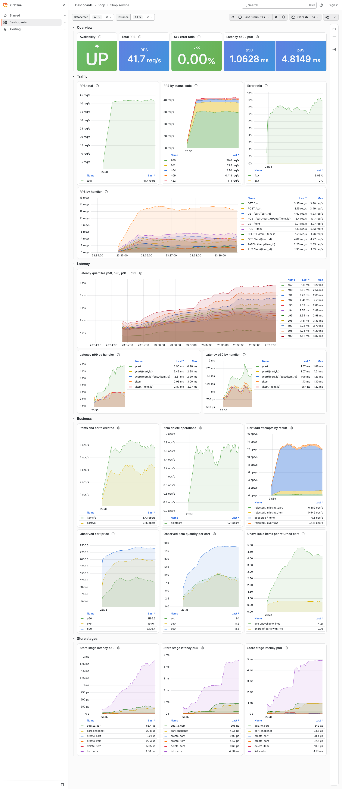
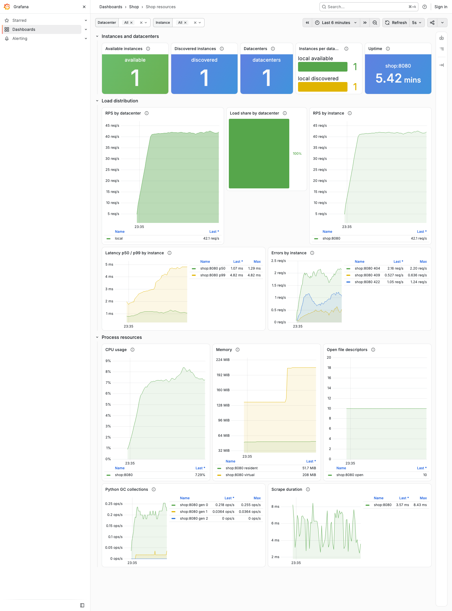
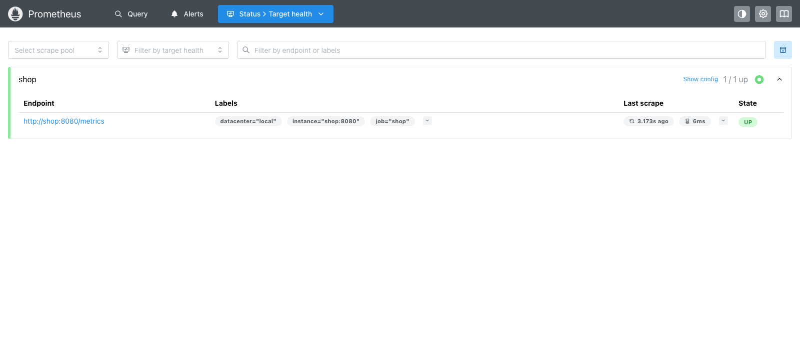

# ДЗ 3: Docker + Prometheus + Grafana

Сервис магазина из ДЗ 2 (`hw2/hw/shop_api`) упакован в Docker и подключён к мониторингу.

## Что есть

| Путь | Назначение |
|------|------------|
| `hw2/hw/Dockerfile` | образ сервиса: `python:3.13-slim`, непривилегированный пользователь `shop`, `uvicorn shop_api.main:app` на порту 8080 |
| `docker-compose.yml` | сервисы `shop`, `prometheus` (`prom/prometheus:v3.15.0`), `grafana` (`grafana/grafana:13.2.3`); healthcheck сервиса по `/metrics` |
| `monitoring/prometheus/prometheus.yml` | job `shop`, таргет `shop:8080`, метка `datacenter="local"`, scrape interval 5s |
| `monitoring/grafana/provisioning/` | автоподключение datasource Prometheus и дашбордов |
| `monitoring/grafana/dashboards/` | дашборды «Shop service» и «Shop resources» |
| `hw2/hw/shop_api/metrics.py` | класс `ShopMetrics` с бизнес-метриками |
| `hw2/hw/test_metrics.py` | тесты `/metrics`: кастомные метрики есть, id в метках нет |
| `hw3/load_generator.py` | ограниченный по времени и RPS генератор нагрузки |
| `.github/workflows/hw3-ci.yml` | CI: тесты на Python 3.13/3.14 и smoke-проверка compose |

## Запуск

```bash
docker compose up -d --build
pip install httpx
python hw3/load_generator.py --duration 300 --rps 40 --concurrency 8
docker compose down -v
```

Параметры генератора: `--duration` (секунды, по умолчанию 60, максимум 3600), `--rps` (по умолчанию 30, максимум 500), `--concurrency` (по умолчанию 8, максимум 64), `--base-url`, `--seed`. Генератор выполняет реальные операции: создание товаров и корзин, добавление в корзину, чтение и фильтрацию списков, `PUT`/`PATCH`, удаление товаров, заведомо неверные запросы (404, 422) и попытки переполнения цены корзины (409). В конце печатает сводку по статусам, операциям и клиентской латентности.

Адреса:

- магазин: <http://localhost:8080> (метрики: <http://localhost:8080/metrics>)
- Prometheus: <http://localhost:9090> (таргеты: <http://localhost:9090/targets>)
- Grafana: <http://localhost:3000> — анонимный доступ на просмотр, админ `admin`/`admin`; дашборды в папке «Shop»

Локально поднят ровно один инстанс сервиса в одном датацентре `local`: панели про датацентры и инстансы показывают 1, а переменные `datacenter` и `instance` позволяют фильтровать, когда таргетов станет больше.

## Метрики

HTTP-метрики даёт `prometheus-fastapi-instrumentator` (коды статусов не группируются, `/metrics` исключён, пути шаблонные, например `/cart/{cart_id}`):

| Метрика | Метки | Смысл |
|---------|-------|-------|
| `http_requests_total` | `handler`, `method`, `status` | число HTTP-запросов |
| `http_request_duration_highr_seconds` | — | гистограмма латентности всех запросов, секунды; бакеты от 0.5 мс до 5 с (21 граница) для p50 и p90…p99 |
| `http_request_duration_seconds` | `handler`, `method` | та же латентность по обработчикам, секунды |
| `process_*`, `python_gc_*` | — | CPU (секунды), память (байты), дескрипторы, GC процесса |

Бизнес-метрики (`ShopMetrics`, id товаров и корзин в метки не попадают):

| Метрика | Метки | Смысл |
|---------|-------|-------|
| `shop_items_created_total` | — | успешно созданные товары (`POST /item`) |
| `shop_carts_created_total` | — | успешно созданные корзины (`POST /cart`) |
| `shop_item_deletes_total` | — | успешные `DELETE /item` (мягкое удаление, повторы включены) |
| `shop_cart_add_attempts_total` | `result` = `accepted`/`rejected`, `reason` = `none`/`missing_cart`/`missing_item`/`overflow` | попытки `POST /cart/{cart_id}/add/{item_id}` |
| `shop_cart_observed_price` | — | гистограмма цены корзины в денежных единицах |
| `shop_cart_observed_item_quantity` | — | гистограмма суммарного количества единиц товара в корзине |
| `shop_cart_observed_unavailable_items` | — | гистограмма числа позиций корзины с удалённым товаром |
| `shop_store_stage_duration_seconds` | `stage` = `create_item`, `update_item`, `delete_item`, `list_items`, `create_cart`, `add_to_cart`, `list_carts`, `cart_snapshot` | время этапов `ShopStore` в секундах, включая ожидание блокировки; `cart_snapshot` — сборка ответа одной корзины с подсчётом цены |

Три `shop_cart_observed_*` гистограммы наблюдаются ровно тогда, когда корзина отдаётся клиенту: `GET /cart/{id}`, каждая корзина из ответа `GET /cart` и успешное добавление товара. Это распределение по выдачам, а не по всем корзинам в хранилище: часто читаемая корзина учитывается чаще. Средняя цена на дашборде не строится: корзины из сценария переполнения (цена около 1e308) делают `_sum` бесконечной, поэтому для цены показаны квантили p50/p75/p90.

## Дашборды

**Shop service**: доступность (`up`), RPS всего / по статусам / по обработчикам, доля 4xx и 5xx, латентность p50 и p90, p91, …, p99, p50/p99 по обработчикам, скорость создания товаров и корзин, удаления, принятые и отклонённые добавления в корзину по причинам, распределения цены, количества и недоступных позиций в выдаваемых корзинах, p50/p95/p99 этапов хранилища.

**Shop resources**: доступные (`sum(up)`) и обнаруженные (`count(up)`) инстансы, число датацентров и инстансы по датацентрам, аптайм, RPS и доля нагрузки по датацентрам, RPS, латентность и ошибки по инстансам, CPU процесса (100% = одно ядро), RSS и виртуальная память, открытые дескрипторы, GC, длительность скрейпа.

Рост латентности под нагрузкой ожидаем: хранилище в памяти, а `GET /cart` с фильтрами пересчитывает цену всех корзин, число которых растёт во время прогона (это видно по этапу `list_carts`).

## Скриншоты

Сделаны после ~5 минут нагрузки `--rps 40 --concurrency 8`.

Shop service:



Shop resources:



Prometheus targets:


