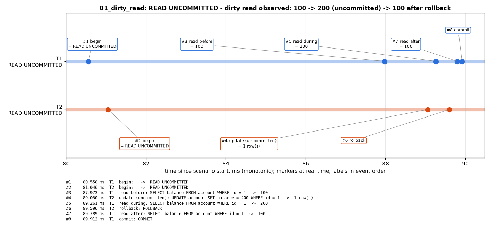
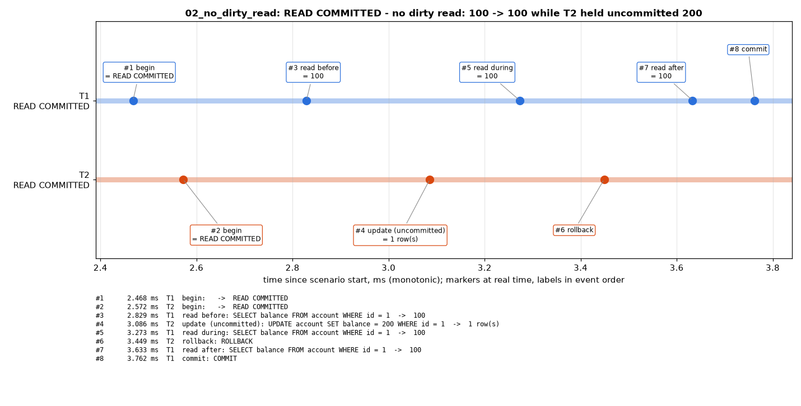
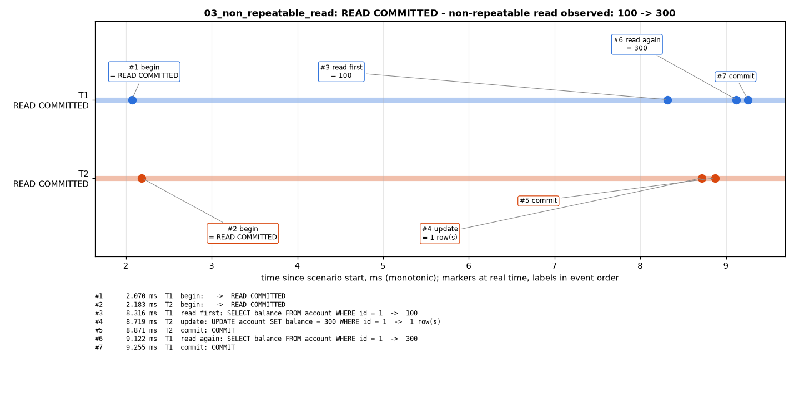
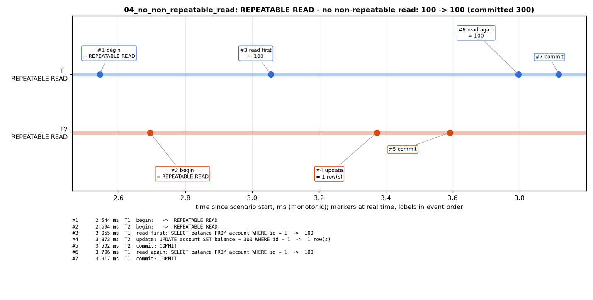
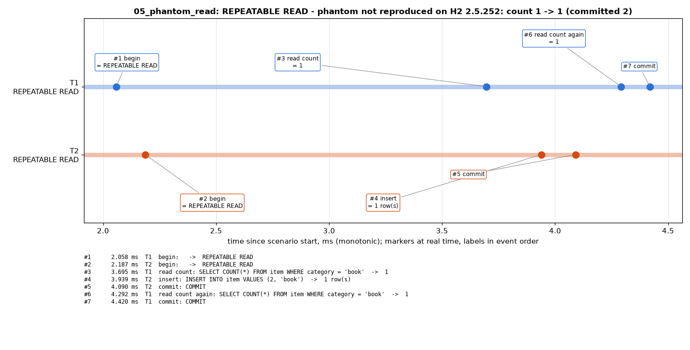
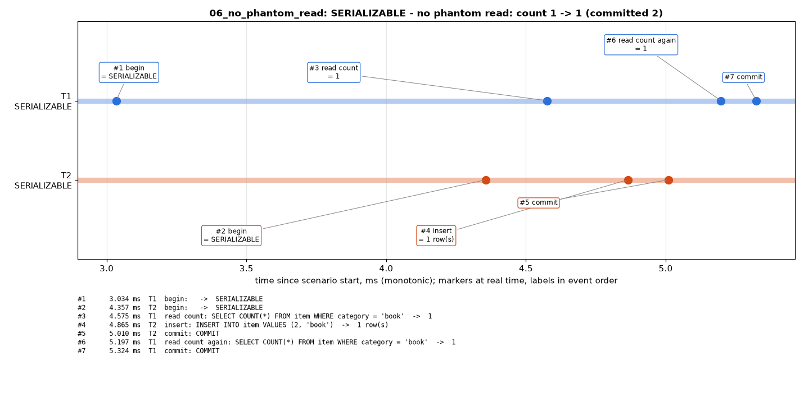

# Лабораторная: уровни изоляции транзакций (ДЗ 4, пункт 3)

Скрипты на Python моделируют аномалии транзакций (dirty read, non-repeatable read, phantom read)
и показывают, как уровни изоляции их устраняют. Python работает с БД через JDBC при помощи
[JPype1](https://jpype.readthedocs.io/); Java-кода в проекте нет.

В каждом сценарии две отдельные JDBC-транзакции T1 и T2 (`DriverManager.getConnection`,
`setAutoCommit(false)`, явный `setTransactionIsolation`) работают в своих Python-потоках.
Порядок шагов задаётся `threading.Event` с ограниченными таймаутами, блокировки в H2
ограничены `LOCK_TIMEOUT` в JDBC URL. Для каждого сценария создаётся новая in-memory БД.
Сценарий проверяет реально прочитанные значения и итоговое закоммиченное состояние. При
любой ошибке или таймауте обе транзакции откатываются, соединения закрываются, а процесс
завершается с ненулевым кодом.

Каждый запуск пишет JSONL-журнал: одна строка на событие (`scenario`, `tx`, `step`, `sql`,
`value`, `isolation`, `t_ms` — монотонное время от начала сценария, `thread`). Визуализатор
строит по журналу шесть таймлайнов.

## Почему H2

[H2](https://h2database.com) — SQL-база данных, написанная на Java (используется строго
версия 2.5.252, jar берётся из Maven Central и проверяется по `.sha1` при сборке образа).
Она выбрана, потому что честно реализует READ UNCOMMITTED и позволяет показать dirty read.
В PostgreSQL этого сделать нельзя: там READ UNCOMMITTED работает как READ COMMITTED.

## Ограничение: phantom read на REPEATABLE READ не воспроизводится

На H2 2.5.252 повторный `SELECT COUNT(*)` в транзакции REPEATABLE READ после вставки и
коммита строки другой транзакцией возвращает то же число: **1 → 1** (закоммиченное значение
при этом уже 2). REPEATABLE READ в H2 построен на MVCC и читает из снимка, сделанного на всю
транзакцию, поэтому новые строки, закоммиченные другой транзакцией, не видны. Стандарт SQL
разрешает phantom read на REPEATABLE READ, но не требует его. Сценарий 5 не подделывает
результат: он проверяет наблюдаемое 1 → 1 и помечает итог как
`phantom not reproduced on H2 2.5.252`. Фантом при этом можно увидеть на READ COMMITTED
(там тот же запрос даёт 1 → 2), но это не входит в шесть сценариев задания.

## Запуск

```bash
cd hw4/isolation_lab
docker build --build-arg PYTHON_VERSION=3.13 -t isolation-lab:3.13 .
docker build --build-arg PYTHON_VERSION=3.14 -t isolation-lab:3.14 .

docker run --rm -v "$PWD/logs:/lab/logs" isolation-lab:3.13 \
  python -m isolation_lab --journal logs/run1.jsonl

docker run --rm -v "$PWD/logs:/lab/logs" -v "$PWD/images:/lab/images" isolation-lab:3.13 \
  python -m isolation_lab.visualizer logs/run1.jsonl images

docker run --rm isolation-lab:3.13 python -m unittest discover -s tests -t . -v
```

Юнит-тесты журнала и визуализатора запускаются и на хосте без Java
(`pip install -r requirements.txt && python -m unittest discover -s tests -t .`),
тесты с H2 при этом пропускаются.

Образ: `python:${PYTHON_VERSION}-slim` + JRE Eclipse Temurin 21 из `eclipse-temurin:21-jre`
(оба официальных образа мультиархитектурные: amd64 и arm64).

## Результаты

Журналы трёх запусков: [`logs/run1.jsonl`](logs/run1.jsonl), [`logs/run2.jsonl`](logs/run2.jsonl),
[`logs/run3.jsonl`](logs/run3.jsonl). Во всех трёх запусках значения одинаковые.

| # | Сценарий | Уровень | Что делает T2 | Чтения T1 | Закоммичено в конце | Итог |
|---|----------|---------|---------------|-----------|---------------------|------|
| 1 | dirty read | READ UNCOMMITTED | `UPDATE 100→200`, затем `ROLLBACK` | 100 → **200** → 100 | 100 | dirty read есть |
| 2 | no dirty read | READ COMMITTED | `UPDATE 100→200`, затем `ROLLBACK` | 100 → 100 → 100 | 100 | dirty read нет |
| 3 | non-repeatable read | READ COMMITTED | `UPDATE 100→300`, `COMMIT` | 100 → **300** | 300 | non-repeatable read есть |
| 4 | no non-repeatable read | REPEATABLE READ | `UPDATE 100→300`, `COMMIT` | 100 → 100 | 300 | non-repeatable read нет |
| 5 | phantom read | REPEATABLE READ | `INSERT` строки, `COMMIT` | count 1 → 1 | 2 | phantom не воспроизводится на H2 2.5.252 |
| 6 | no phantom read | SERIALIZABLE | `INSERT` строки, `COMMIT` | count 1 → 1 | 2 | phantom нет |

На SERIALIZABLE H2 2.5.252 не блокирует вставку T2 и не откатывает T1: T1 просто читает
из своего снимка.

### 1. Dirty read (READ UNCOMMITTED)


### 2. Нет dirty read (READ COMMITTED)


### 3. Non-repeatable read (READ COMMITTED)


### 4. Нет non-repeatable read (REPEATABLE READ)


### 5. Phantom read (REPEATABLE READ): не воспроизводится на H2 2.5.252


### 6. Нет phantom read (SERIALIZABLE)

